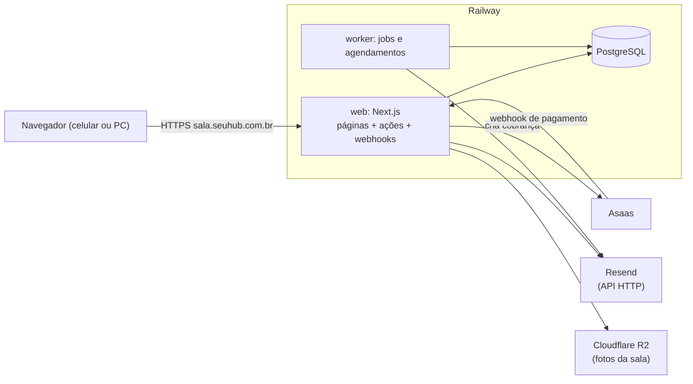

# Arquitetura e stack do MVP (rascunho v0.2)

Data: 2026-10-17 · Base: [visao.md](visao.md), [jornadas-e-telas.md](jornadas-e-telas.md), [modelo-de-dados.md](modelo-de-dados.md).

## 1. Decisões já tomadas

- **Next.js + PostgreSQL**, tudo em TypeScript.
- Hospedagem no **Railway**.
- Endereço em **subdomínio do Hub SaaS** (ex.: `sala.seuhub.com.br`).
- Pagamentos pelo **Asaas** (pessoa física), Pix e cartão.

## 2. Visão geral



- **Um repositório, um monólito modular**, publicado como **dois serviços** a partir do mesmo código:
  - **web**: Next.js (páginas, ações do usuário, endpoint de webhook do Asaas).
  - **worker**: processo Node sempre ligado que roda os jobs (prazos, lembretes, vencimentos).
- **PostgreSQL** gerenciado pelo Railway, com backup.
- DNS: um CNAME de `sala.<domínio do Hub>` para o serviço web no Railway.

## 3. Stack

| Camada | Escolha | Por quê |
|---|---|---|
| Linguagem | TypeScript | Um tipo só do banco à tela. |
| Framework web | Next.js (App Router) | Página pública renderizada no servidor (SEO) e área logada no mesmo projeto. |
| UI | Tailwind CSS + shadcn/ui | Componentes prontos e acessíveis, fáceis de ajustar ao celular. |
| Banco | PostgreSQL 16 + `btree_gist` | As restrições `EXCLUDE` garantem no banco que não há conflito de horário nem violação da trava. |
| Acesso ao banco | Drizzle ORM + migrações SQL | Próximo do SQL; aceita migração manual para `tstzrange` e `EXCLUDE`, que ORMs mais fechados não modelam. |
| Autenticação | Better Auth (e-mail e senha) | Verificação de e-mail, recuperação de senha e sessões no próprio Postgres, sem serviço externo. Papéis `anfitriao` e `profissional`. |
| Validação | Zod | Mesma validação no formulário e no servidor. |
| Jobs | pg-boss | Fila e agendamento sobre o próprio Postgres: sem Redis, um serviço a menos. |
| Datas | date-fns + @date-fns/tz | Conversões explícitas para `America/Sao_Paulo`. |
| E-mail | **Resend**, pela API HTTP [T3] | API simples, modelos de e-mail em React; plano gratuito cobre o MVP. API HTTP em vez de SMTP, que costuma ser bloqueado ou instável em hospedagens de nuvem. |
| Pagamento | Asaas API v3 | Pix (QR exibido na própria tela) e cartão (pela **página de fatura do Asaas**: nenhum dado de cartão passa pelo nosso servidor). |
| Fotos da sala | **Cloudflare R2** [T4] | Compatível com S3, gratuito no volume do MVP, sem custo de saída; sem disco no servidor. |
| Erros | Sentry (plano gratuito) | Saber de um erro antes do usuário avisar. |
| Testes | Vitest + Postgres real em Docker; Playwright | Unidade para as regras, integração para as restrições do banco, ponta a ponta para o fluxo de reserva. |

## 4. Organização do código

```
src/
  app/
    (publico)/          T01 página da sala, T02 cadastro, T03 login
    (profissional)/     T10 a T16
    (anfitriao)/        T20 a T26
    api/webhooks/asaas/ recebe avisos de pagamento
  modulos/
    identidade/   usuários, profissionais, aprovação de cadastro
    agenda/       regras, preço, reservas, séries, bloqueios, ocupação
    cobranca/     Asaas, cobranças, recibos
    carteira/     créditos, lotes, uso e vencimento
    financeiro/   relatórios e exportação
    comunicacao/  e-mails e modelos de mensagem
    configuracao/ espaço, turnos, preços, regras, documentos legais
    auditoria/    registro de ações
  db/             esquema Drizzle e migrações
worker/           jobs do pg-boss
```

**Regra:** as telas não falam com o banco; chamam funções dos módulos. Toda regra de negócio (preço, prazos, política de cancelamento, trava) mora no módulo e tem teste.

## 5. Fluxos técnicos principais

### 5.1 Pedido de reserva
1. Valida as regras (funcionamento, antecedência, duração) e calcula o preço.
2. Numa **transação**: grava a `reserva` (`solicitada`), a `ocupacao` e o `aceite` do termo.
3. Se o banco recusar a ocupação (restrição 1 ou 2), a resposta é "este horário acabou de ser reservado"; nada fica gravado.
4. Agenda o job de expiração da aprovação e avisa o Anfitrião por e-mail.

### 5.2 Aprovação
1. Calcula o crédito a usar (D8).
2. Se o crédito cobre tudo: consome os lotes e a reserva vai direto a `confirmada`.
3. Senão: cria (ou reaproveita) o cliente no Asaas, cria a cobrança do restante, grava `cobranca` e itens, muda a reserva para `aguardando_pagamento`, agenda a expiração do pagamento e envia o link.

### 5.3 Pagamento (webhook do Asaas)
1. Confere o token do webhook, grava em `webhook_evento` e ignora se o `evento_id` já existe.
2. Cobrança paga: marca `paga`, confirma as reservas dos itens (ou cria o lote de crédito, se for compra), emite o recibo, envia e-mails.
3. **Pagamento depois da expiração [T1]:** tenta recriar a ocupação da reserva. Se o banco aceitar (horário ainda livre), a reserva volta e é confirmada. Se recusar, o valor pago vira **lote de crédito integral** na carteira, sem estorno, e o Profissional recebe e-mail explicando.
4. Tudo numa transação; se falhar, o evento fica com erro para reprocessar.

### 5.4 Jobs do worker

| Job | Quando |
|---|---|
| Expirar aprovação e pagamento | No prazo exato de cada reserva (agendado na criação), mais uma varredura a cada 5 min como rede de segurança |
| Marcar reservas como realizadas e apagar o código de acesso | A cada hora |
| Lembrete da véspera | Diário, às 18h |
| Créditos vencendo (aviso de 7 dias) e vencidos (baixa do saldo) | Diário |
| Série perto do fim (renovar) | Diário |
| Gerar cobranças por ocorrência das séries | Diário, respeitando o prazo antes de cada data |

## 6. Segurança e LGPD

- Senhas com hash forte (pela biblioteca de autenticação); sessão em cookie `httpOnly` e `secure`.
- Autorização por papel em **toda** ação do servidor, não só na tela.
- Dados mínimos do Profissional (CPF e registro); nenhum documento enviado.
- Nenhum dado de cartão no sistema.
- Webhook autenticado por token; segredos só em variáveis de ambiente.
- Registro de auditoria das ações do Anfitrião e de quem acessou o quê.
- Backup diário do banco.

## 7. Ambientes e custos

- **Local:** Postgres em Docker, Asaas em modo sandbox, e-mails capturados localmente.
- **Produção:** Railway (web + worker + Postgres) com Asaas real.
- Homologação separada é opcional no MVP; o sandbox do Asaas cobre os testes de pagamento.
- **Custo estimado do Railway:** algo como US$ 5 a 20 por mês para esse porte. Confirmar no painel depois do primeiro mês. E-mail e Sentry cabem nos planos gratuitos no início.

## 8. Decisões técnicas (revisadas em 2026-10-17)

| # | Ponto | Decisão |
|---|---|---|
| **T1** | Pagamento que chega **depois** da reserva expirar | Se o horário ainda estiver livre, reconfirma a reserva. Se não, o valor vira **crédito integral** na carteira (sem estorno, sem taxa). |
| **T2** | Código de acesso | Guardado na reserva até ela terminar (o Profissional vê na tela) e apagado depois pelo job horário. |
| **T3** | Provedor de e-mail | **Resend**. Exige configurar SPF e DKIM no DNS do domínio do Hub. |
| **T4** | Fotos da sala | **Cloudflare R2**. |

## 9. Riscos técnicos

- **Fuso horário:** maior fonte de bugs em agenda. Mitigação: hora local só nas bordas, testes com horários perto da meia-noite e das trocas de turno.
- **Asaas como pessoa física:** confirmar limites, taxas e se o webhook e a API de Pix estão disponíveis para conta PF antes de começar a fase de pagamento.
- **Concorrência na agenda:** coberta pelas restrições do banco, com teste de dois pedidos simultâneos.
- **Domínio do Hub:** o e-mail transacional depende do DNS do Hub estar disponível para SPF e DKIM.
