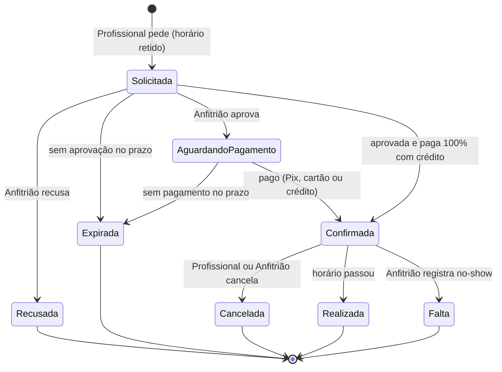
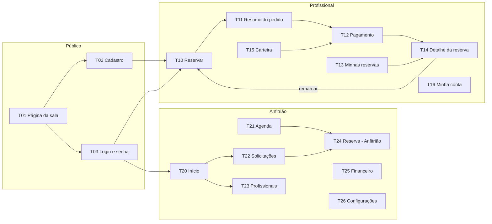

# Jornadas e mapa de telas do MVP (rascunho v0.2)

Data: 2026-10-17 · Base: [visao.md](visao.md) v0.4. Nada codificado.

Onde uma regra da visão não bastou para fechar uma jornada, ela foi decidida e marcada com **[D#]**. As decisões estão na seção 6.

## 1. Papéis e estados

**Papéis**
- **Visitante:** sem login. Vê a página pública da sala, **sem a agenda** [D1].
- **Profissional:** cadastrado. Estados: `pendente` → `aprovado` | `recusado`; um aprovado pode ser `bloqueado` pelo Anfitrião. O `pendente` já vê a agenda e pode pedir reserva [D2].
- **Anfitrião:** você e sua esposa, **cada um com a própria conta** e as mesmas permissões [D7].

**Ciclo de vida da reserva**

- **Retido** (Solicitada e AguardandoPagamento) já ocupa a agenda e gera a trava de 1 hora.
- Recusada, Expirada e Cancelada liberam o horário na hora.
- Uma **série** é um pedido com várias ocorrências; cada ocorrência segue esse mesmo ciclo depois de aprovada.

## 2. Jornadas do Profissional

### P1. Descoberta e cadastro
1. Chega à **página pública** por Google, Instagram, indicação ou anúncio.
2. Vê fotos, o que está incluso, endereço e preços. **A agenda só aparece depois do login** [D1].
3. Clica em "Quero reservar".
4. **Cadastro em passos:** dados pessoais → profissão e registro no conselho (CRM/CRP/outro + nº + UF) → senha → **aceite do contrato** (registrado com data, hora, IP e versão).
5. Confirma o e-mail.
6. Entra no sistema com cadastro `pendente`, com um aviso fixo "cadastro em análise". Já vê a agenda e pode **mandar o primeiro pedido de reserva** [D2].
7. O Anfitrião aprova cadastro e pedido juntos. O Profissional recebe e-mail com o resultado.

### P2. Reserva avulsa (hora, turno ou dia)
1. Abre **Reservar** e vê a semana. Pode trocar para hora, turno ou dia.
2. Seleciona o horário. A tela mostra só o que pode ser reservado (respeitando funcionamento, bloqueios, trava, antecedência de 24h a 60 dias).
3. **Resumo do pedido:** horário, preço (sempre o menor possível), saldo de crédito e opção "usar crédito" (ligada por padrão) [D8].
4. Aceita o **termo da reserva** e envia. Status: Solicitada.
5. Recebe e-mail da aprovação com o **link de pagamento** e o prazo.
6. Paga por Pix ou cartão. Se o crédito cobriu tudo, a reserva já é confirmada na aprovação.
7. Recebe a confirmação com recibo e, depois, o **código de acesso** e as instruções de chegada.
8. Recebe **lembrete na véspera** [D6].

Caminhos alternativos: recusada (e-mail com motivo opcional); expirada por falta de aprovação ou pagamento (e-mail avisando que o horário foi liberado). Os prazos estão em [D3].

### P3. Reserva recorrente (série)
1. Em **Reservar**, liga "Repetir": dia(s) da semana, hora ou turno, semanal ou quinzenal, data final.
2. O sistema lista as ocorrências e marca as que estão indisponíveis. O Profissional aceita a série sem elas ou ajusta.
3. Escolhe o pagamento: **pacote do mês** (10% de desconto) ou **por ocorrência**.
4. Aceita o termo e envia. O Anfitrião aprova a série inteira.
5. Pacote: um link de pagamento para o mês. Por ocorrência: um link por data, enviado com antecedência.
6. Perto do fim da série, recebe a opção **"Renovar série"** [D4].

### P4. Cancelar e remarcar
1. Em **Minhas reservas**, abre a reserva → "Cancelar".
2. A tela mostra quanto volta como crédito pela política (100%, 50% ou 0%) **antes** de confirmar.
3. Confirma; o crédito entra na carteira com validade.
4. **Remarcar** é um atalho: cancela e abre **Reservar** com o crédito já aplicado. A nova reserva passa por aprovação.

### P5. Comprar crédito (banco de horas)
1. Em **Carteira**, vê saldo, validade e extrato.
2. Escolhe um pacote (ex.: paga R$ 450, recebe R$ 500) e paga.
3. O crédito entra com validade de 90 dias.

### P6. Minha conta
Dados cadastrais, troca de senha, contrato aceito (versão e data), recibos.

## 3. Jornadas do Anfitrião

### A1. Configuração inicial (uma vez)
Sala e página pública (fotos, descrição, endereço, comodidades) → funcionamento e turnos → preços → regras (antecedência, trava, prazos, cancelamento) → pacotes de crédito e desconto do pacote → textos do contrato e do termo → conta Asaas → dados do recibo.

### A2. Bloquear a agenda
- **Uso próprio** (atendimentos da esposa): gera trava. Pode ser recorrente ("toda segunda e quarta, 07h–12h").
- **Indisponível** (manutenção, feriado, folga): só fecha o horário.
- Se o bloqueio cair sobre reserva existente, o sistema avisa e pede para cancelar a reserva primeiro (com crédito integral ao Profissional).

### A3. Aprovar cadastro
1. Vê o alerta no **Início** e abre o Profissional pendente.
2. Confere o registro no site do conselho (link pronto pelo tipo de conselho e UF).
3. Aprova ou recusa (motivo opcional). Se o Profissional já mandou pedidos enquanto pendente [D2], aprova cadastro e pedidos juntos. Recusar o cadastro recusa os pedidos e libera os horários.

### A4. Aprovar reserva ou série
1. Abre **Solicitações**: cada pedido mostra Profissional, horários, valor e histórico (reservas anteriores, faltas).
2. Aprova ou recusa. Na aprovação, o sistema gera a cobrança no Asaas e envia o link.

### A5. Dia a dia
1. **Início** mostra o que precisa de ação: cadastros e reservas para aprovar, códigos de acesso a enviar, pagamentos prestes a expirar, reservas de hoje e amanhã.
2. **Enviar código de acesso** (manual no MVP): na reserva confirmada, digita o código gerado no app da fechadura → o sistema envia por e-mail com as instruções e registra o envio.
3. **Agenda** em visão de semana e mês, com cores por status.

### A6. Exceções
- Cancelar reserva pelo Anfitrião: crédito de 100% (ou reembolso em dinheiro, como exceção).
- Registrar **falta** (no-show): sem devolução.
- Conceder crédito manual (cortesia, compensação).
- Bloquear Profissional (não reserva mais; reservas futuras ficam para o Anfitrião decidir).

### A7. Financeiro
Receita e ocupação do mês, lançamentos (pagamentos, créditos, usos, vencimentos, estornos), extrato por Profissional, **créditos em aberto** (o que vocês devem em uso futuro), recibos e **relatório mensal para o carnê-leão** (exportação).

## 4. Notificações (e-mail no MVP) [D5]

| Evento | Para |
|---|---|
| Novo cadastro / nova solicitação | Anfitrião |
| Cadastro aprovado ou recusado | Profissional |
| Reserva aprovada, com link e prazo de pagamento | Profissional |
| Reserva recusada / expirada | Profissional |
| Pagamento recebido / reserva confirmada, com recibo | Profissional e Anfitrião |
| Código de acesso e instruções | Profissional |
| Lembrete da véspera | Profissional |
| Reserva cancelada (com crédito gerado) | Profissional e Anfitrião |
| Crédito vencendo em 7 dias | Profissional |
| Série perto do fim (renovar) | Profissional |

## 5. Mapa de telas do MVP

### Público

| Tela | Para quê | Elementos principais |
|---|---|---|
| **T01 Página da sala** | Convencer e levar ao cadastro | Fotos, descrição, o que está incluso, endereço/mapa, tabela de preços, dias e horário de funcionamento, botão "Quero reservar", WhatsApp. **Sem agenda** [D1]. Otimizada para Google. |
| **T02 Cadastro** | Criar conta | Passos: dados, conselho, senha, contrato (rolagem + aceite). Ao terminar, abre T10 com o aviso "cadastro em análise". |
| **T03 Login e senha** | Entrar, recuperar senha, confirmar e-mail | Um login só; o papel decide se abre T10 ou T20. |

### Profissional

| Tela | Para quê | Elementos principais |
|---|---|---|
| **T10 Reservar** | Escolher horário | Semana navegável; alternar hora, turno, dia; "Repetir" para série; só horários reserváveis clicáveis. |
| **T11 Resumo do pedido** | Revisar e enviar | Horários (ou lista de ocorrências da série), preço e cálculo, crédito, forma de pagamento da série, termo com aceite, enviar. |
| **T12 Pagamento** | Pagar | Pix (QR e copia-e-cola), cartão, valor, prazo restante. Serve para reserva, série e compra de crédito. |
| **T13 Minhas reservas** | Acompanhar | Abas: próximas, pendentes, passadas. Status com cor. |
| **T14 Detalhe da reserva** | Tudo sobre uma reserva | Linha do tempo do status, pagar (se pendente), código de acesso, recibo, cancelar e remarcar (com prévia do crédito). |
| **T15 Carteira** | Créditos | Saldo, validades, extrato, comprar pacote. |
| **T16 Minha conta** | Dados | Dados cadastrais, senha, contrato aceito, recibos. |

### Anfitrião

| Tela | Para quê | Elementos principais |
|---|---|---|
| **T20 Início** | O que fazer hoje | Pendências com contador (cadastros, solicitações, códigos a enviar, pagamentos expirando), reservas de hoje e amanhã, números do mês. |
| **T21 Agenda** | Ver e bloquear | Semana e mês, cores por status, criar bloqueio (uso próprio ou indisponível, com repetição). |
| **T22 Solicitações** | Aprovar | Fila de reservas e séries pendentes, com prazo; aprovar e recusar em um clique. |
| **T23 Profissionais** | Gerir pessoas | Lista com filtro por estado; detalhe com dados, link do conselho, histórico, carteira, aprovar, recusar, bloquear, crédito manual. |
| **T24 Reserva (Anfitrião)** | Agir numa reserva | Dados, pagamento, enviar código, cancelar, registrar falta, histórico de ações. |
| **T25 Financeiro** | Dinheiro | Resumo do mês, lançamentos com filtros, extrato por Profissional, créditos em aberto, recibos, exportar relatório mensal. |
| **T26 Configurações** | Regras do negócio | Abas: Sala e página · Funcionamento e turnos · Preços e pacotes · Regras e prazos · Cancelamento · Contrato e termo (com versões) · Pagamento (Asaas) · Usuários Anfitrião. |

**Total: 17 telas** (3 públicas, 7 do Profissional, 7 do Anfitrião). Tudo responsivo: o Profissional vai reservar pelo celular; o Anfitrião vai aprovar pelo celular.

## 6. Decisões (revisadas em 2026-10-17)

| # | Decisão | Por quê |
|---|---|---|
| **D1** | A **agenda só aparece depois do login**. A página pública mostra preços e funcionamento, mas não a disponibilidade. | Escolha dos donos: privacidade sobre a ocupação da sala. (A proposta original era mostrar livre/ocupado sem login.) |
| **D2** | O Profissional **pendente já vê a agenda e pode pedir reserva**; o Anfitrião aprova cadastro e pedidos juntos. | Uma aprovação em vez de duas; o Profissional não precisa voltar depois. |
| **D3** | **Prazos encadeados:** aprovação em até **12h** e pagamento em até **2h**, mas os dois terminam no máximo **6h antes do início** da reserva. Parametrizáveis. | Com antecedência mínima de 24h, os prazos atuais (sem limite) poderiam passar do horário da reserva. |
| **D4** | **Série limitada a 60 dias** (a antecedência máxima) e renovada com "Renovar série" perto do fim. | Uma série maior furaria a antecedência máxima. A renovação também é o ponto natural para a cobrança recorrente da fase 2. |
| **D5** | Notificações **só por e-mail** no MVP; WhatsApp na fase 2. | E-mail é grátis e simples; WhatsApp exige conta Business e templates aprovados. |
| **D6** | **Lembrete da véspera** já no MVP. | Custo baixo, reduz falta. |
| **D7** | **Duas contas de Anfitrião** (você e sua esposa), mesmas permissões, com registro de quem fez cada ação. | Os dois vão operar; o registro evita "quem aprovou isso?". |
| **D8** | "Usar crédito" **ligado por padrão** no pedido, e o crédito usado é o que vence primeiro. | Evita crédito vencido sem uso. |
