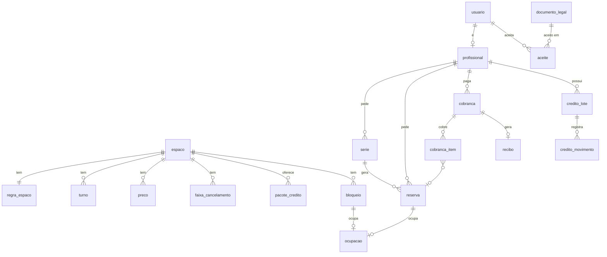

# Modelo de dados do MVP (rascunho v0.1)

Data: 2026-10-17 · Base: [visao.md](visao.md) v0.4 e [jornadas-e-telas.md](jornadas-e-telas.md) v0.2 · Banco: PostgreSQL (ver [arquitetura.md](arquitetura.md)).

## 1. Convenções

- **Dinheiro em centavos** (`integer`). Nada de `float`.
- **Momentos** em `timestamptz` (UTC no banco). **Regras de agenda** (funcionamento, turnos, véspera) são em hora local de `America/Sao_Paulo`; a conversão acontece num lugar só do código.
- **Datas sem hora** (início e fim de série) em `date`. Nunca converter `date` em momento sem dizer o fuso.
- **Ids** `uuid`. Nomes de tabelas e colunas em português, no singular.
- Toda tabela tem `criado_em`; as que mudam de estado guardam também **quem** mudou (`..._por`) e **quando** (`..._em`).

## 2. Visão geral

## 3. Tabelas

### 3.1 Identidade

**usuario**: `id`, `email` (único, sem diferenciar maiúsculas), `nome`, `telefone`, `papel` (`anfitriao` | `profissional`), `email_verificado_em`, `ativo`, `criado_em`.
Senha, sessões e tokens de verificação ficam nas tabelas da biblioteca de autenticação.

**profissional** (1:1 com usuario): `usuario_id` (PK), `cpf` (único), `profissao` (`psiquiatra` | `psicologo` | `terapeuta` | `outro`), `conselho` (`CRM` | `CRP` | `outro`), `registro_numero`, `registro_uf`, `status` (`pendente` | `aprovado` | `recusado` | `bloqueado`), `avaliado_por`, `avaliado_em`, `motivo_avaliacao`, `asaas_cliente_id`.

### 3.2 Espaço e regras (tudo que é parametrizável)

**espaco**: `id`, `nome`, `slug`, `descricao`, endereço (logradouro, número, complemento, bairro, cidade, UF, CEP), `comodidades` (`text[]`), `fuso` (padrão `America/Sao_Paulo`), `ativo`.
**espaco_foto**: `id`, `espaco_id`, `url`, `legenda`, `ordem`.

**regra_espaco** (1 linha por espaço):

| Coluna | Valor inicial |
|---|---|
| `dias_funcionamento` (`smallint[]`, 1 = segunda) | {1,2,3,4,5,6} |
| `abre` / `fecha` (`time`) | 07:00 / 22:00 |
| `antecedencia_min_horas` | 24 |
| `antecedencia_max_dias` | 60 |
| `duracao_min_horas` | 1 |
| `trava_minutos` | 60 |
| `prazo_aprovacao_horas` | 12 |
| `prazo_pagamento_horas` | 2 |
| `corte_antes_inicio_horas` | 6 |
| `validade_credito_dias` | 90 |
| `desconto_pacote_mes_pct` | 10 |
| `aviso_renovacao_serie_dias` | 7 |
| `hora_lembrete_vespera` (`time`) | 18:00 |

Mais `atualizado_por` e `atualizado_em`.

**turno**: `id`, `espaco_id`, `nome`, `inicio` (`time`), `fim` (`time`), `ordem`, `ativo`. Inicial: Turno 1 07:00–12:00; Turno 2 13:00–22:00.

**preco**: `id`, `espaco_id`, `unidade` (`hora` | `turno` | `dia`), `turno_id` (só para `turno`), `valor_centavos`, `vigente_desde`. Inicial: hora 5000; turno 1 20000; turno 2 30000; dia 45000.
A reserva grava o valor calculado, então mudar o preço não altera reservas existentes. Colunas futuras previstas: `dia_semana`, `profissional_id`.

**faixa_cancelamento**: `id`, `espaco_id`, `antecedencia_min_horas`, `percentual_credito`. Inicial: (48, 100), (24, 50), (0, 0).

**pacote_credito**: `id`, `espaco_id`, `nome`, `valor_pago_centavos`, `valor_credito_centavos`, `ativo`. Ex.: 45000 → 50000.

### 3.3 Contrato e termo

**documento_legal**: `id`, `tipo` (`contrato` | `termo_reserva`), `versao`, `texto`, `publicado_em`, `publicado_por`. Único por (`tipo`, `versao`). Nunca se edita uma versão publicada; publica-se outra.

**aceite**: `id`, `usuario_id`, `documento_id`, `aceito_em`, `ip`, `user_agent`, `reserva_id` (opcional), `serie_id` (opcional).

### 3.4 Agenda

**serie**: `id`, `espaco_id`, `profissional_id`, `dias_semana` (`smallint[]`), `frequencia` (`semanal` | `quinzenal`), `unidade`, `turno_id` ou `hora_inicio`/`hora_fim`, `data_inicio`, `data_fim` (no máximo 60 dias à frente), `forma_pagamento` (`pacote_mes` | `por_ocorrencia`), `status` (`solicitada` | `aprovada` | `recusada` | `expirada` | `encerrada` | `cancelada`), `renovacao_de_id` (série anterior, D4), `aprovada_por`, `aprovada_em`.

**reserva** (uma por intervalo contínuo; uma série gera uma reserva por ocorrência):

| Coluna | Observação |
|---|---|
| `id`, `espaco_id`, `profissional_id`, `serie_id` | `serie_id` nulo na avulsa |
| `inicio`, `fim` | `fim > inicio`, horas cheias |
| `unidade`, `turno_id` | como foi pedida |
| `valor_cheio_centavos`, `desconto_centavos`, `valor_centavos` | preço calculado na hora do pedido (seção 5) |
| `status` | `solicitada` · `aguardando_pagamento` · `confirmada` · `realizada` · `falta` · `recusada` · `expirada` · `cancelada` |
| `prazo_aprovacao_ate`, `prazo_pagamento_ate` | calculados pelos prazos encadeados (D3) |
| `aprovada_por`, `aprovada_em`, `motivo_recusa` | |
| `cancelada_por`, `cancelada_em`, `credito_gerado_centavos` | |
| `codigo_acesso`, `codigo_acesso_enviado_por`, `codigo_acesso_enviado_em` | código apagado quando a reserva termina |

**bloqueio**: `id`, `espaco_id`, `tipo` (`uso_proprio` | `indisponivel`), `inicio`, `fim`, `motivo`, `grupo_id` (bloqueios criados juntos por repetição), `criado_por`.

### 3.5 Ocupação: a regra que impede conflito

Reservas e bloqueios vivem em tabelas diferentes, mas disputam o mesmo tempo. A tabela **ocupacao** junta os dois e deixa o **banco** garantir as regras, mesmo com dois pedidos chegando no mesmo segundo.

**ocupacao**: `id`, `espaco_id`, `periodo` (`tstzrange` de início a fim), `periodo_com_trava` (`tstzrange`), `gera_trava` (bool), `ocupante` (`prof:<id>` ou `anfitriao`), `reserva_id` (único, opcional), `bloqueio_id` (único, opcional). Exatamente um dos dois preenchido.

- `periodo_com_trava` = o período **alargado em metade da trava de cada lado**. Com trava de 60 min: reserva 9h–10h vira 8h30–10h30.
- **Restrição 1: nada se sobrepõe.** `EXCLUDE USING gist (espaco_id WITH =, periodo WITH &&)`.
- **Restrição 2: trava entre ocupantes diferentes.** `EXCLUDE USING gist (espaco_id WITH =, ocupante WITH <>, periodo_com_trava WITH &&) WHERE (gera_trava)`. Requer a extensão `btree_gist`.

Conferindo com as regras:

| Caso | Resultado |
|---|---|
| A 9h–10h (8h30–10h30) e B 10h–11h (9h30–11h30) | Rejeitado pela restrição 2: B só pode a partir das 11h |
| A 9h–10h e B 11h–12h (10h30–12h30) | Aceito: os intervalos só se encostam |
| A 9h–10h e A 10h–11h | Aceito: mesmo ocupante, e os períodos só se encostam |
| Turno 1 (07h–12h) e turno 2 (13h–22h) de pessoas diferentes | Aceito: 6h30–12h30 e 12h30–22h30 só se encostam |
| Uso próprio da esposa (gera trava, ocupante `anfitriao`) | Trava como qualquer Profissional |
| Indisponível (feriado) ao lado de reserva | Aceito: `gera_trava = false`, só vale a restrição 1 |

**Ciclo:** a linha de ocupação nasce junto com a reserva (`solicitada`) ou o bloqueio e é **apagada na mesma transação** em que a reserva vira `recusada`, `expirada` ou `cancelada`, ou o bloqueio é removido. Se a trava for alterada nas configurações, vale só para ocupações novas.

### 3.6 Cobrança

**cobranca**: `id`, `profissional_id`, `finalidade` (`reserva` | `pacote_mes` | `ocorrencia` | `compra_credito`), `valor_bruto_centavos`, `desconto_centavos`, `credito_usado_centavos`, `valor_cobrado_centavos`, `status` (`pendente` | `paga` | `expirada` | `cancelada` | `estornada`), `meio` (`pix` | `cartao` | `credito` | `pix_manual`; o último é marcado como pago pelo Anfitrião, ver [plano-de-entregas.md](plano-de-entregas.md)), `marcada_paga_por`, `asaas_cobranca_id` (único), `asaas_link_fatura`, `pix_copia_cola`, `vence_em`, `pago_em`.

**cobranca_item**: `id`, `cobranca_id`, `reserva_id` ou `pacote_credito_id`, `valor_centavos`. Uma cobrança de pacote do mês tem um item por ocorrência.

**recibo**: `id`, `numero` (sequencial), `cobranca_id` (único), `emitido_em`. O PDF é gerado na hora, a partir dos dados.

### 3.7 Carteira de créditos

Crédito é guardado em **lotes**, porque cada entrada tem validade própria e o uso consome primeiro o que vence antes (D8).

**credito_lote**: `id`, `profissional_id`, `origem` (`compra` | `cancelamento` | `pagamento_atrasado` | `ajuste_manual`), `valor_inicial_centavos`, `saldo_centavos` (entre 0 e o inicial), `validade_ate`, `cobranca_id` (se compra), `reserva_id` (se cancelamento), `criado_por`.

**credito_movimento**: `id`, `lote_id`, `tipo` (`entrada` | `uso` | `devolucao_uso` | `vencimento` | `ajuste`), `valor_centavos` (com sinal), `reserva_id`, `cobranca_id`, `criado_por`, `criado_em`.

- **Saldo** = soma dos `saldo_centavos` dos lotes ainda válidos.
- **Uso**: trava os lotes do Profissional (`FOR UPDATE`), consome por `validade_ate` crescente, grava um movimento por lote tocado.
- **Bônus do banco de horas**: o lote nasce com o valor do crédito (R$ 500); a cobrança registra o valor pago (R$ 450).

### 3.8 Registro e integração

**notificacao**: `id`, `usuario_id`, `tipo`, `canal` (`email`), `assunto`, `status` (`enviado` | `falhou`), `erro`, `referencia_tipo`, `referencia_id`, `enviado_em`. Único por (`tipo`, `referencia_id`, `usuario_id`) nos envios automáticos, para um lembrete nunca sair duas vezes.

**evento_auditoria**: `id`, `usuario_id` (nulo = sistema), `acao`, `entidade`, `entidade_id`, `dados` (`jsonb`), `ip`, `criado_em`. Responde "quem aprovou, cancelou ou deu crédito" (D7).

**webhook_evento**: `id`, `provedor` (`asaas`), `evento_id` (único), `tipo`, `payload` (`jsonb`), `recebido_em`, `processado_em`, `erro`. Garante que um aviso de pagamento repetido não é processado duas vezes.

## 4. Financeiro: de onde vêm os números (T25)

Não há tabela própria de "lançamentos". Os relatórios saem das tabelas acima:

| Número | Fonte |
|---|---|
| Receita do mês (carnê-leão) | `cobranca` paga em dinheiro (Pix/cartão), pelo `pago_em` em hora local, menos estornos |
| Créditos em aberto (o que vocês devem em uso futuro) | soma do saldo dos `credito_lote` válidos |
| Crédito usado / vencido no mês | `credito_movimento` do tipo `uso` / `vencimento` |
| Ocupação | horas de `reserva` confirmada ou realizada ÷ horas de funcionamento |
| Extrato por Profissional | `cobranca` + `credito_movimento` do Profissional |

## 5. Regra de preço ("menor preço possível")

Para uma reserva de um intervalo contínuo num dia:

1. Para cada turno, conta as horas do pedido que caem dentro dele: custo do turno = **o menor entre** (horas × preço da hora) e (preço do turno).
2. Horas fora de turno (12h–13h) custam o preço da hora.
3. Soma tudo. O preço final é **o menor entre** essa soma e o preço do dia.
4. Série em pacote do mês: aplica o desconto (10%) sobre o valor de cada ocorrência.

| Pedido | Cálculo | Preço |
|---|---|---|
| 9h–12h | turno 1: min(3 × 50, 200) | R$ 150 |
| 8h–12h | turno 1: min(4 × 50, 200) | R$ 200 |
| 7h–12h | turno 1: min(5 × 50, 200) | R$ 200 |
| 9h–14h | turno 1: min(150, 200) + 12h–13h: 50 + turno 2: min(50, 300) | R$ 250 |
| 13h–22h | turno 2: min(9 × 50, 300) | R$ 300 |
| 7h–22h | min(200 + 50 + 300, 450) | R$ 450 |

## 6. Observações

- **Código de acesso** fica guardado na reserva até ela terminar (o Profissional vê em T14) e é apagado depois (decisão T2 em [arquitetura.md](arquitetura.md)).
- **Pagamento atrasado** (decisão T1): ao chegar depois da expiração, o sistema tenta recriar a `ocupacao`; se o banco recusar, cria um `credito_lote` de origem `pagamento_atrasado` com o valor pago.
- **Turnos de horário fixo:** se um turno mudar de horário, as reservas já feitas mantêm o horário em que foram pedidas.
