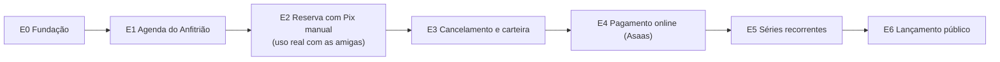

# Plano de entregas do MVP (rascunho v0.1)

Data: 2026-10-17 · Base: [visao.md](visao.md), [jornadas-e-telas.md](jornadas-e-telas.md), [modelo-de-dados.md](modelo-de-dados.md), [arquitetura.md](arquitetura.md).

## 1. Princípios do fatiamento

1. **Cada etapa termina no ar** (Railway, produção) e é usável por alguém. Nada de "tudo pronto só no fim".
2. **Uso real o quanto antes.** As duas amigas interessadas começam a reservar na **Etapa 2**, com pagamento por Pix manual: a regra de pagar antes de confirmar continua valendo, só que o Anfitrião confirma o recebimento na mão. Assim a agenda, as regras e os e-mails são testados com gente de verdade antes de integrar o Asaas.
3. **Riscos primeiro.** O que pode derrubar o projeto (conta Asaas de pessoa física, restrições de conflito no banco, fuso horário) é testado logo no início.
4. **Lançamento público só no fim** (Etapa 6), quando a página pública, as configurações e o financeiro estiverem completos.

## 2. Visão geral

| Etapa | Entrega | Quem usa ao fim | Tamanho relativo |
|---|---|---|---|
| E0 | Projeto no ar com login | Só vocês | P |
| E1 | Agenda com bloqueios e regras | Vocês (agenda da esposa) | M |
| E2 | Reserva avulsa ponta a ponta, Pix manual | Vocês + as 2 amigas | G |
| E3 | Cancelamento, remarcação e créditos | Idem | M |
| E4 | Pix e cartão automáticos, banco de horas, recibos | Idem | G |
| E5 | Séries recorrentes com pacote do mês | Idem | M |
| E6 | Página pública, configurações completas, financeiro | Qualquer Profissional | G |

## 3. Etapas

### E0. Fundação
**Objetivo:** a base técnica funcionando em produção.
- Repositório Next.js + TypeScript, Tailwind + shadcn/ui, lint, verificação de tipos, Vitest.
- PostgreSQL local em Docker; Drizzle com a primeira migração.
- Railway: serviço **web**, serviço **worker** (pg-boss, um job de teste) e Postgres com backup.
- Better Auth: login, logout, recuperação de senha, verificação de e-mail; papéis `anfitriao` e `profissional`. As duas contas de Anfitrião (D7) criadas por script.
- Resend ligado (e-mail de verificação).
- Sentry e tabela `evento_auditoria` (o registro começa desde já; a tela vem depois).
- CI no GitHub: lint, tipos e testes a cada push.
- **Teste de risco:** abrir a conta **Asaas sandbox** e confirmar, por um script, criação de cliente com CPF, cobrança Pix e recebimento do webhook. Se algo bloquear pessoa física, sabemos agora.

**Pronto quando:** vocês dois entram no sistema pelo endereço de produção, e o teste do Asaas sandbox passou.

### E1. Agenda do Anfitrião
**Objetivo:** a agenda da sala existe e já serve para vocês.
- Tabelas de espaço, regras, turnos e preços, com os valores iniciais carregados por seed (a tela completa de configuração fica para a E6).
- Tabela `ocupacao` com as **duas restrições EXCLUDE** e testes de integração: conflito, trava de 1h nos dois sentidos, mesmo Profissional emendando, turnos seguidos, bloqueio indisponível sem trava, **dois pedidos simultâneos**.
- Bloqueios **uso próprio** e **indisponível**, com repetição ("toda segunda e quarta, 07h–12h").
- **T21 Agenda** (semana e mês) e **T20 Início** em versão inicial.
- Testes de fuso: horários perto da meia-noite e das trocas de turno.

**Pronto quando:** os atendimentos da esposa estão lançados como bloqueios e a agenda mostra a sala real.

### E2. Reserva avulsa com Pix manual (primeiro uso real)
**Objetivo:** as duas amigas reservam, pagam e entram na sala.
- **Contrato e termo** (`documento_legal` + `aceite`), com texto provisório.
- **Cadastro do Profissional** (T02), cadastro pendente com aviso (D2), aprovação de cadastro (T23 inicial) com link para o site do conselho.
- **Reservar** (T10) por hora, turno ou dia; **regra do menor preço** com testes; **resumo do pedido** (T11) com aceite do termo.
- **Solicitações** (T22): aprovar e recusar; aprovação conjunta de cadastro + pedidos.
- **Prazos encadeados** (D3) e jobs de expiração no worker.
- **Pagamento manual:** ao aprovar, o e-mail traz a chave Pix e o valor; o Anfitrião marca "pago" em T24. Fica gravado como `cobranca` com meio `pix_manual` (ver seção 5).
- **Código de acesso** digitado pelo Anfitrião em T24, enviado por e-mail, guardado até o fim da reserva (T2).
- **Minhas reservas** (T13) e **detalhe** (T14); **lembrete da véspera** (D6); demais e-mails da tabela de notificações.
- **T20 Início** com as pendências (cadastros, solicitações, códigos a enviar, pagamentos expirando).

**Pronto quando:** uma das amigas fez uma reserva real do pedido até a entrada na sala.

### E3. Cancelamento, remarcação e carteira
**Objetivo:** imprevistos resolvidos pelo sistema, sem conversa por fora.
- **Carteira** em lotes com validade (`credito_lote`, `credito_movimento`) e testes de consumo pela validade (D8) e de concorrência.
- **Cancelamento** pelo Profissional com prévia do crédito pela política (100%, 50%, 0%); cancelamento pelo Anfitrião com crédito integral; registro de **falta**.
- **Remarcação** como atalho (cancela e abre Reservar com o crédito).
- **Usar crédito** no pedido, ligado por padrão; reserva paga 100% com crédito é confirmada direto na aprovação.
- **Crédito manual** do Anfitrião; jobs de **aviso de vencimento** e **vencimento**.
- **T15 Carteira** (saldo, validades, extrato).

**Pronto quando:** um cancelamento real gerou crédito e esse crédito pagou uma nova reserva.

### E4. Pagamento online (Asaas)
**Objetivo:** fim da conferência manual de Pix.
- Cliente e cobrança no Asaas ao aprovar; **T12 Pagamento** com QR Pix e copia-e-cola; cartão pela página de fatura do Asaas.
- **Webhook** autenticado e idempotente (`webhook_evento`); confirmação automática; **pagamento atrasado** (T1).
- **Recibo** numerado com PDF.
- **Banco de horas:** pacotes de crédito com bônus, comprados em T15 e pagos pelo Asaas.
- O Pix manual continua disponível como exceção do Anfitrião.

**Pronto quando:** uma reserva real foi paga por Pix e confirmada sem ninguém tocar no sistema.

### E5. Séries recorrentes
**Objetivo:** horário fixo semanal ou quinzenal.
- Pedido de série em T10/T11: dias, frequência, data final (até 60 dias), lista de ocorrências indisponíveis.
- Aprovação da série inteira em T22.
- **Pacote do mês** (10% de desconto, uma cobrança com vários itens) ou **por ocorrência** (cobrança gerada pelo worker antes de cada data).
- Cancelamento de ocorrência pela política, com crédito sobre o valor com desconto.
- **Renovar série** (D4) com aviso perto do fim.

**Pronto quando:** uma amiga tem horário fixo pago como pacote do mês.

### E6. Lançamento público
**Objetivo:** abrir para qualquer Profissional.
- **T01 Página da sala** com SEO (título, descrição, dados estruturados de local), fotos no **Cloudflare R2**, preços e funcionamento, sem agenda (D1).
- **T26 Configurações** completa: sala e página, funcionamento e turnos, preços e pacotes, regras e prazos, **política de cancelamento** (já guardada em `regra_espaco`: `cancelamento_integral_horas` = 48, `cancelamento_parcial_horas` = 24, `cancelamento_parcial_pct` = 50; a E6 só ganha a tela para editar, e o banco recusa combinações inválidas), contrato e termo com versões, pagamento, usuários Anfitrião.
- **T25 Financeiro**: resumo do mês, lançamentos, extrato por Profissional, créditos em aberto, recibos, **exportação mensal para o carnê-leão**.
- T23 completa (bloquear Profissional, histórico, carteira) e tela de auditoria.
- Política de privacidade e textos finais de contrato e termo **revisados por advogado**.
- Subdomínio definitivo do Hub; Perfil da Empresa no Google; anúncio em marketplaces de salas.

**Pronto quando:** um Profissional desconhecido achou a página, se cadastrou e reservou.

## 4. Pendências externas (não são código)

| Pendência | Necessária antes de | Responsável |
|---|---|---|
| Conta Asaas **sandbox** | E0 (teste de risco) | Vocês |
| Ler o contrato de locação: o proprietário permite sublocar? | **E2** (primeiro uso real) | Vocês |
| Texto provisório de contrato e termo | E2 | Vocês, com rascunho meu |
| **Domínio com DNS** para o Resend enviar a terceiros (SPF/DKIM) | **E2** | Vocês / Hub SaaS |
| Fechadura comprada (com API) ou código fixo provisório | E2 | Vocês |
| Conversa com o contador (carnê-leão, Pix como PF, crédito vendido antes do uso) | E4 | Vocês |
| Conta Asaas de **produção** verificada | E4 | Vocês |
| Advogado: contrato, termo e política de privacidade | **E6** | Vocês |
| Licenças do consultório para outros profissionais | E6 | Vocês |

O Resend só envia para endereços de terceiros com um **domínio verificado**. Se o subdomínio do Hub não estiver pronto até a E2, dá para verificar um domínio provisório.

## 5. Ajustes no modelo de dados

- `cobranca.meio` ganha o valor **`pix_manual`** (E2): cobrança marcada como paga pelo Anfitrião, com `pago_em` e quem marcou.

## 6. O que fica para depois do MVP (fase 2)

Cobrança recorrente no cartão, código automático na fechadura, WhatsApp, integração com Google Agenda ou iConsultório, Profissionais de confiança com aprovação automática.

## 7. Definição de pronto (vale para toda etapa)

- No ar em produção, testado no celular.
- Regras de negócio da etapa com testes automatizados; CI verde.
- Migrações aplicadas sem perder dados.
- Documentos em `docs/` atualizados com o que mudou.

## 8. Andamento (atualizado em 2026-10-19)

**E0 concluída.** No ar em `web-production-b82ba.up.railway.app` (web + worker + Postgres), com login dos dois Anfitriões validado em produção, Resend, Sentry, CI verde e repositório em `nelsonlouzada/subloc-consultorio`.

**Teste de risco do Asaas sandbox: aprovado.** Cliente com CPF, cobrança Pix, QR Code com copia-e-cola e webhook (5 envios com resposta 200 em produção, token conferido, idempotência por `webhook_evento`). Pessoa física não é bloqueio. A chave Pix da conta é pré-requisito para gerar o QR Code.

Confirmado em produção em 2026-10-19: worker no ar com batimento a cada 5 minutos; TCP Proxy público do Postgres desligado.

Pendência que sobra da E0: verificar um domínio no Resend antes da E2 (hoje o Resend só entrega para o e-mail da própria conta).

Lições da implantação (valem para as próximas etapas):
- Variável no Railway com **espaço no nome** (colada junto) é descartada em silêncio. Conferir tamanho e presença das variáveis antes de culpar o código.
- O build automático do Railway (Railpack) falhou com "secret not found"; o `Dockerfile` próprio resolveu e é usado pelos dois serviços.
- Valor com `#` em `.env` precisa de aspas (vira comentário).
- No PowerShell, `npm` pode ser bloqueado pela política de execução: usar `npm.cmd`.
- Porta 5432 local já era de outro Postgres: o banco deste projeto usa a 5433.

### E1: agenda do Anfitrião (2026-10-19)

Feito e verificado no navegador (desktop e celular), com 32 testes automatizados:
- Tabelas `espaco`, `regra_espaco`, `turno`, `preco`, `bloqueio` e `ocupacao`, com os valores iniciais carregados por `npm run seed:espaco` (idempotente).
- As duas restrições `EXCLUDE` (sem sobreposição; trava de 1 h entre ocupantes diferentes) e o `CHECK` de "reserva ou bloqueio" estão em `drizzle/0003_ocupacao_restricoes.sql`. Testes de integração no Postgres real cobrem: trava nos dois sentidos, mesmo ocupante emendando, turnos seguidos, indisponível sem trava, uso próprio com trava, rollback, **20 pedidos simultâneos (passa exatamente um)** e fuso (22h-24h, virada de dia). Conferido removendo a restrição de propósito: 7 testes falham.
- Bloqueios de uso próprio e indisponível, avulsos ou repetidos ("toda segunda e quarta, 07h-12h"); datas já ocupadas são puladas e avisadas; remoção de um bloqueio ou da repetição inteira.
- Telas: login (T03 inicial), Início (T20 inicial) e Agenda (T21: semana, mês, criação e remoção de bloqueios).

Para o deploy: o **Pre-deploy Command** do `web` no Railway passa a ser `npm run deploy:preparar`, para a sala nascer sozinha em produção.

Fica para depois (E6): fotos, endereço e demais campos da sala, e a tela de configuração das regras.

### E2, bloco A: base de dados e preço (2026-10-19)

Feito: tabelas `profissional`, `documento_legal`, `aceite`, `reserva`, `cobranca` e `cobranca_item` (migração 0004), com `ocupacao.reserva_id` ligada à reserva. Regra do menor preço em `src/modulos/agenda/preco.ts` (24 testes, incluindo a tabela do modelo de dados e a garantia de que pedir mais horas nunca custa menos) e leitura da tabela vigente em `src/modulos/configuracao/precos.ts`. 62 testes no total.

Próximos blocos da E2: B (cadastro e aprovação), C (reservar), D (aprovação e prazos), E (pagamento manual e acesso).

### E2, bloco B: cadastro e aprovação do Profissional (2026-10-19)

Feito e verificado no navegador (cadastro em 3 passos, e-mail de verificação, login, aviso de cadastro em análise, aprovação pelo Anfitrião): validação de CPF; contrato e termo provisórios (versão 1, a revisar por advogado na E6); aceite com data, IP, navegador e versão; tabela `notificacao` com registro de todo e-mail, sem duplicar e sem derrubar o fluxo quando o envio falha; T02 (cadastro), T23 (lista com filtro por estado e detalhe com link do conselho, aprovar, recusar com motivo, bloquear e desbloquear), área do Profissional com aviso por estado e contador de pendências no menu e no Início. Recusar um cadastro recusa os pedidos em aberto e libera os horários (testado). 101 testes.

Para o uso real: o Resend só entrega ao e-mail da conta até haver domínio verificado; sem isso, as amigas não recebem o e-mail de confirmação e não conseguem entrar. O cadastro não tem limite de tentativas contra cadastros em massa: tratar na E6.

### E2, bloco C: reservar (2026-10-20)

Feito e verificado no navegador (Profissional pendente pede um turno, vê o resumo com preço, aceita o termo e envia; o Anfitrião vê a reserva na agenda): conferência única do pedido (`avaliarPedido`, usada pelo resumo e pela criação), disponibilidade com as mesmas regras do banco (testada contra o Postgres em todas as combinações de início e fim), opções do dia, T10 (semana, turno, hora, dia inteiro, Meus pedidos) e T11 (resumo, como o valor foi calculado, termo com aceite). O preço nunca vem do formulário. Teto de 5 pedidos em aberto por Profissional (decisão de produto a confirmar). 136 testes.

Falta na E2: bloco D (aprovação e prazos), bloco E (pagamento manual e acesso).

### E2, bloco D: aprovação e prazos (2026-10-20)

Feito e verificado no navegador (Profissional pendente pede o dia inteiro; o Anfitrião aprova cadastro e pedido juntos na T22; o pedido vira "aguardando pagamento" com cobrança e prazo) e no worker real (um pedido vencido foi expirado sozinho em cerca de um minuto): aprovar com prazo de pagamento encadeado (D3), recusar liberando o horário, aprovar cadastro e pedido juntos (A3), expiração por falta de aprovação e por falta de pagamento (com a cobrança), job no worker a cada minuto, e-mails de aprovada, recusada e expirada, T22 (para aprovar e aguardando pagamento) e contadores no menu e no Início. 151 testes, incluindo decisões simultâneas e dois processos expirando ao mesmo tempo.

Para o deploy: o serviço `worker` no Railway precisa das variáveis `RESEND_API_KEY`, `EMAIL_REMETENTE` e `BETTER_AUTH_URL` (ele agora envia e-mail e monta links), além de `DATABASE_URL`. E, para o e-mail de aprovação trazer o Pix, `PIX_MANUAL_CHAVE` e `PIX_MANUAL_NOME` no serviço `web` e no `worker`.

Falta na E2: bloco E (pagamento manual, código de acesso, minhas reservas, lembrete da véspera).

### E2, bloco E: pagamento manual e acesso (2026-10-20)

Feito e verificado no navegador e por requisições reais (o Anfitrião marca o pagamento por Pix, a reserva fica confirmada, ele envia o código; a profissional vê a reserva, o código e a linha do tempo): `marcarPago` (cobrança paga com meio `pix_manual`; pagamento depois da expiração reativa a reserva se o horário ainda está livre, e recusa se não está), código de acesso por e-mail com reenvio (guardado só até a reserva terminar; nunca vai para a auditoria), encerramento de hora em hora (reserva terminada vira realizada e o código é apagado), lembrete da véspera na hora configurada (18h) sem duplicar, pendências no Início (códigos a enviar e pagamentos que vencem em até 1 hora), T24 (reserva do Anfitrião), T13 e T14 (Minhas reservas e detalhe, só do dono da reserva). 172 testes, incluindo pagamento e expiração no mesmo instante.

**Código da E2 completo.** Para o "pronto" do plano (uma amiga reservar de verdade, do pedido até a entrada na sala) faltam as pendências externas: domínio verificado no Resend, contrato de locação, fechadura (ou código fixo provisório), chave Pix de recebimento e as variáveis do Railway (web e worker).

### E3: cancelamento, créditos e remarcação (2026-10-20)

Código completo, com 208 testes (Postgres real, incluindo concorrência e mutação: sem a devolução de crédito na expiração, 2 testes falham). Ainda **não** visto no navegador: as telas novas foram verificadas só por tipos, lint e testes de módulo.

- **Carteira em lotes** (`credito_lote`, `credito_movimento`, migração 0006): validade por lote (90 dias, configurável em `regra_espaco`), uso pelo que vence primeiro (D8) com `FOR UPDATE`, vencimento por job horário no worker, T15 `/carteira` (saldo, validades, extrato).
- **Usar crédito no pedido** (D8): ligado por padrão no resumo; o crédito abate **na aprovação**, na mesma transação da decisão. Se cobre tudo, a reserva é confirmada na hora (cobrança paga com meio `credito`). Se o pedido expira, é cancelado ou o Pix chega atrasado, o crédito volta (ou é abatido de novo).
- **Política de cancelamento da profissional** (migração 0007): 100% do valor em crédito com 48 h ou mais, 50% de 24 h a 48 h, nada abaixo, calculada sobre o valor da reserva. Os três números ficam em `regra_espaco` (`cancelamento_integral_horas`, `cancelamento_parcial_horas`, `cancelamento_parcial_pct`), e o banco recusa combinações incoerentes. **Parametrizável na T26 (E6): a tela é a única coisa que falta.** Prévia do crédito antes de confirmar; retirar pedido sem resposta; Anfitriões avisados.
- **Cancelamento pelo Anfitrião**: horário liberado, código apagado, crédito **integral** se já estava pago.
- **Remarcação**: atalho em Minhas reservas (cancela pela política e abre Reservar com o crédito pronto para uso).
- **Crédito manual** do Anfitrião (na ficha do profissional): motivo obrigatório, registrado na auditoria e enviado por e-mail.
- **Registro de falta** (e desfazer): sem crédito, apaga o código e entra no histórico mostrado na aprovação.
- **Pagamento atrasado**: se o horário não volta, o valor pago vira crédito (`pagamento_atrasado`) em vez de erro.
- **Recuperação de senha** (fora do plano, mas necessária antes de abrir): "Esqueci minha senha" e redefinição, link de 1 hora e uso único.

Para o deploy: migrações 0006 e 0007 rodam sozinhas no Pre-deploy Command (`npm run deploy:preparar`). O worker ganhou o job `vencer-creditos`.

### E4: pagamento online pelo Asaas (2026-10-20)

Código completo, com 227 testes, e **verificado contra o sandbox real do Asaas** (cliente com CPF, cobrança Pix, QR Code e copia-e-cola criados de verdade; o aviso de pagamento foi simulado localmente com o formato do Asaas). Telas T12 e recibo vistas no navegador. Ainda **não** foi testado com um aviso que o próprio Asaas envia (isso exige o `web` no ar no Railway).

- **Chave `ASAAS_ATIVO`**: o pagamento online só liga com `ASAAS_ATIVO=true`. Desligado, ou se o Asaas falhar na hora de aprovar, tudo segue pelo Pix manual da E2: aprovar um pedido nunca depende de o Asaas estar no ar.
- **Aprovação**: cria (ou reaproveita) o cliente no Asaas e uma cobrança Pix do **restante** (depois do crédito); guarda QR, copia-e-cola e link da fatura (cartão, pela página do Asaas: nenhum dado de cartão passa pelo sistema). Reserva paga 100% com crédito não gera cobrança.
- **T12 Pagamento** em Minhas reservas (e em `/carteira/pagar/[id]` para compra de crédito).
- **Webhook** (`/api/webhooks/asaas`): token, idempotência (`webhook_evento`), confere o valor recebido contra o cobrado e a referência da cobrança; confirma a reserva sozinho. Aviso repetido não faz nada; aviso que falhou é reaplicado quando o Asaas reenviar (a resposta é 500 só nesse caso). Problemas de dados (cobrança desconhecida, valor diferente) ficam em `webhook_evento.erro` e no Sentry, com resposta 200, para o Asaas não reenviar para sempre.
- **Pagamento atrasado (T1)**: reativa se o horário está livre, senão vira crédito. Se a reserva já foi **cancelada** (ou paga por outro meio), o valor também vira crédito integral.
- **Cancelar** reserva não paga cancela a cobrança no Asaas (melhor esforço).
- **Recibo** numerado em sequência (`recibo`, migração 0008), um por cobrança paga com dinheiro; PDF gerado na hora em `/api/recibos/[cobrancaId]` (só o dono e os Anfitriões). Quem recebe (nome e documento) vem de `RECIBO_EMITENTE_NOME` e `RECIBO_EMITENTE_DOC`; sem isso a linha não aparece, para o sistema nunca inventar um dado fiscal.
- **Banco de horas**: tabela `pacote_credito`; a carteira mostra "Comprar" só com o pagamento online ligado, cadastro aprovado e algum pacote ativo. O crédito (com bônus) entra quando o pagamento é reconhecido. **Nenhum pacote vem cadastrado**: valores e bônus são decisão do Anfitrião (tela na T26, E6; até lá, inserção no banco).

Para ligar em produção (depois do Railway voltar): `ASAAS_ATIVO=true`, `ASAAS_API_KEY` e `ASAAS_WEBHOOK_TOKEN` no `web` (o webhook já está cadastrado no Asaas com o mesmo token), `ASAAS_BASE_URL` só se for sair do sandbox. **Antes de usar o Asaas real com dinheiro**, falta a conversa com o contador (carnê-leão, Pix como pessoa física, crédito vendido antes do uso) e confirmar os limites da conta PF.

### E5: séries recorrentes (2026-10-25)

Código completo, com 278 testes (Postgres real), e **verificado no navegador** de ponta a ponta (a profissional pede a série, o Anfitrião aprova e confirma o pacote do mês, a profissional vê o recibo e cancela a série, e o crédito da política bate: R$ 22,50 + R$ 45,00). A verificação achou três defeitos reais, corrigidos: colisão de rotas entre as telas do Anfitrião e da profissional, histórico da série sem o pagamento, e datas da cobrança fora de ordem.

- **Pedido (P3, T10/T11):** `/reservar/serie`: dias da semana, semanal ou quinzenal, hora/turno/dia, período de até 60 dias (D4) e forma de pagamento. O resumo lista as datas (as indisponíveis ficam de fora, com o motivo) e o preço. Cada data vira uma reserva `solicitada`, todas retendo o horário na mesma transação. A série conta como **um** pedido no teto de 5.
- **Aprovação (A4):** a série inteira de uma vez, na T22 (como um pedido só) e na página da série (`/series-da-sala/[id]`). Cadastro pendente aprova junto. As datas passam ao novo estado `aprovada` (horário retido, cobrança ainda não gerada).
- **Cobrança:** *pacote do mês* (10% de desconto, uma cobrança por mês: o primeiro na aprovação, os seguintes 3 dias antes de cada mês) ou *por data* (um link por data, 3 dias antes), com o crédito (D8) abatendo cada cobrança e o Asaas/Pix manual como nas reservas avulsas. O worker gera as cobranças (job `cobrar-series`, de hora em hora). Data que fica sem cobrança perto demais do início é liberada.
- **Pagamento de várias datas de uma vez:** vale para o Pix manual e para o Asaas. Pagamento atrasado data a data: as livres voltam, as tomadas viram crédito. Sem saldo para reabater o crédito, o dinheiro que chegou vira crédito integral (e o aviso do Asaas, que não pode falhar para sempre, é tratado; o mesmo foi corrigido para a reserva avulsa).
- **Cancelamento:** de uma data (pela política; data de pacote ainda não pago não sai sozinha) ou da **série inteira** (pagamentos abertos são cancelados e o crédito que os abatia volta; datas pagas voltam em crédito pela política, cada uma pela própria antecedência, ou integral se for o Anfitrião).
- **Renovação (D4):** `/series/[id]` oferece "Renovar série" com o pedido já preenchido para o período seguinte (mesmo ritmo, no máximo 60 dias à frente); a renovação é um pedido novo, ligado ao anterior. Um aviso por e-mail sai uma vez, quando faltam `aviso_renovacao_serie_dias` (7) dias (job `renovar-series`).
- **Telas novas:** profissional: Séries (lista), `/series/[id]`, `/reservar/serie` e resumo; Anfitrião: `/series-da-sala/[id]` e as séries na fila de Solicitações. Série aprovada/encerrada fica em "Pendentes" em Minhas reservas.

Para o deploy: a migração 0009 roda sozinha no pré-deploy. O worker ganhou os jobs `cobrar-series` e `renovar-series`.

Fica para depois: ajuste de uma série já aprovada (hoje se cancela e se pede de novo), cobrança por cartão recorrente (fase 2) e a tela da T26 para editar o desconto do pacote do mês e o aviso de renovação (hoje em `regra_espaco`).

### E6, em andamento (2026-10-27)

Feito e verificado no navegador, com testes (429 no total):
- **T26 Configurações** (`/configuracoes`), em abas: *Regras e prazos* (funcionamento, antecedência, prazos, **política de cancelamento**, validade do crédito, desconto do pacote, avisos), *Preços* (valores novos valem a partir de uma data, com histórico e agendamento; reservas já feitas mantêm o valor), *Turnos* (nome, horário, ativo; turno antigo é desativado, nunca apagado), *Sala e página* (nome, descrição, endereço e comodidades), *Contrato e termo* (publicar versão nova; a publicada nunca é editada e quem já aceitou fica na versão dele), *Pagamento* e *Anfitriões* (só leitura: chaves ficam no Railway, contas de Anfitrião são criadas por script). Toda mudança grava antes e depois na auditoria, com quem fez e o IP.
- **T25 Financeiro** (`/financeiro`): resumo do mês (recebido, crédito usado e vencido, créditos em aberto, ocupação), por profissional, lançamentos com link do recibo e **exportação em CSV para o carnê-leão** (`/api/financeiro/carne-leao?mes=AAAA-MM`: data, nome e CPF do pagador, descrição, meio, valor e recibo, com total). Regime de caixa: conta o dinheiro quando entra, e pagamento só com crédito não entra. Cada exportação fica na auditoria porque leva CPF. **Confirmar com o contador** como tratar o crédito comprado e ainda não usado.

Falta da E6: página pública da sala (T01, com fotos no Cloudflare R2 e SEO), auditoria e T23 completa, política de privacidade e textos finais revisados por advogado, e o login recusar usuário com `ativo = false` (hoje esse campo só controla quem recebe os avisos por e-mail).
